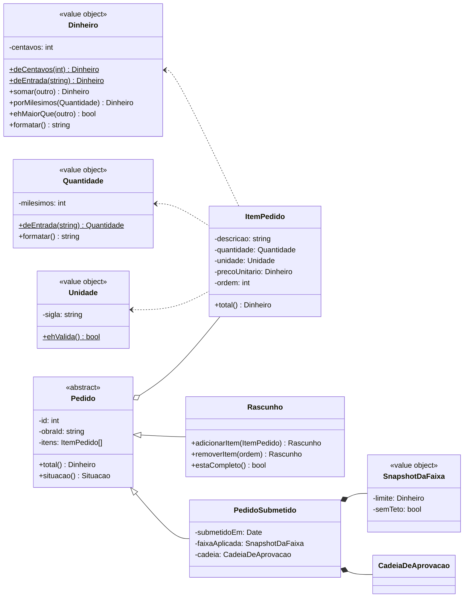
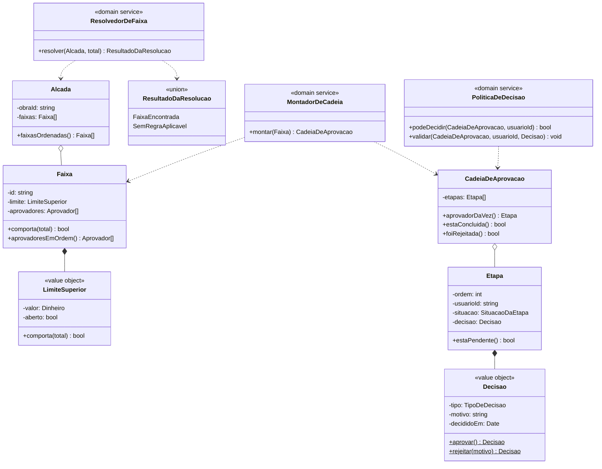
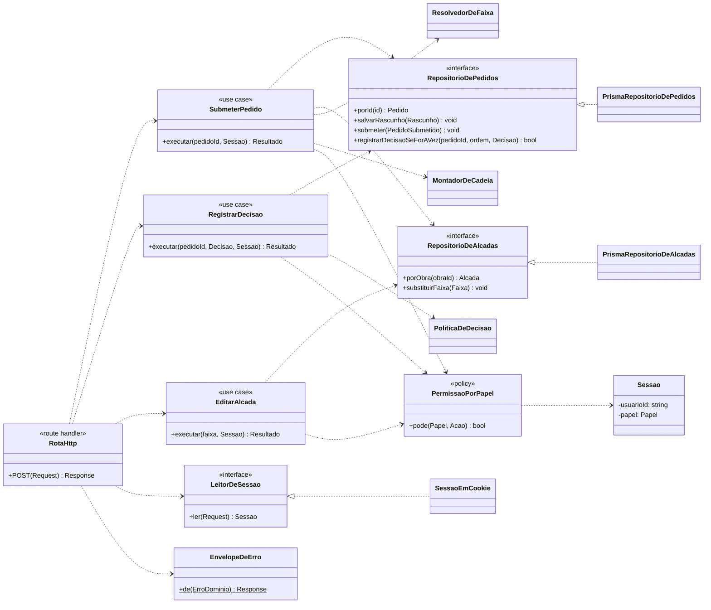

# Aprovações do ObraFlow — diagrama de classes

Cada caixa é **uma responsabilidade única**. O critério aplicado: uma classe só existe se houver
um motivo de mudança que seja exclusivamente dela. Se duas caixas mudam sempre juntas, são uma.

---

## 1 · Valores e pedido

Objetos de valor imutáveis e as entidades que os compõem. Nenhuma delas conhece banco, HTTP ou
regra de alçada.

**Por que `Rascunho` e `PedidoSubmetido` são tipos distintos.** O glossário diz que o rascunho é
"incompleto por natureza, sem cadeia, sem aprovador e sem decisão possível", e que depois da
submissão "cabeçalho e itens são imutáveis". Um tipo só, com metade dos campos nulável, obrigaria
toda leitura a perguntar em qual metade da vida o pedido está. Dois tipos tornam a pergunta
desnecessária: `PedidoSubmetido` não tem `adicionarItem`, então ninguém pode chamá-lo.

**Por que `total()` é método e não campo.** O total é derivado dos itens; guardá-lo como estado
cria a possibilidade de divergir deles. A persistência grava o derivado por conveniência de
consulta, mas a verdade é o cálculo.

---

## 2 · Alçada e cadeia

O núcleo da regra. É aqui que mora o que vale a nota, e é aqui que os ADRs 0001, 0002 e 0004 se
tornam código.

**Três serviços em vez de um.** `ResolvedorDeFaixa`, `MontadorDeCadeia` e `PoliticaDeDecisao`
poderiam ser métodos de `Alcada`. São separados porque mudam por motivos diferentes: a resolução
muda se a regra de faixa mudar (ADR 0002), a montagem muda se a ordem dos aprovadores passar a
depender de algo além da faixa, e a política de decisão muda se surgir delegação ou veto. Juntos,
qualquer uma dessas mudanças tocaria as outras duas.

**`SemRegraAplicavel` é um resultado, não uma exceção.** O glossário trata o estado como legítimo:
"impede a submissão, mas não impede que o rascunho continue existindo". Exceção obrigaria o
chamador a tratá-lo como falha; união obriga-o a tratá-lo como caso.

**`CadeiaDeAprovacao` não sabe resolver faixa.** Ela é o snapshot do ADR 0001 — um registro
histórico. Dar a ela acesso à `Alcada` abriria a porta para recalcular, que é exatamente o que o
ADR proíbe.

---

## 3 · Portas, casos de uso e borda

A inversão de dependência: o domínio declara as portas, a infraestrutura as implementa. Nenhuma
seta aponta de dentro para fora.

**`registrarDecisaoSeForAVez` devolve booleano, não pedido.** É a assinatura do ADR 0004: uma
escrita condicionada ao estado que a autoriza, em que zero linhas afetadas significa que a premissa
caiu. Um método que lesse e depois escrevesse teria outra assinatura — e seria a corrida que o ADR
rejeita.

**`LeitorDeSessao.ler` recebe `Request`.** Não é detalhe de estilo: é o que mantém o seam de Route
Handler viável. `cookies()` de `next/headers` lança fora de uma requisição real do Next, e o teste
do INC5 monta o `Request` à mão.

**A rota não contém regra.** Ela lê sessão, valida entrada, chama um caso de uso e traduz o
resultado em resposta. Toda a lógica que vale nota está abaixo dela, alcançável sem HTTP.

---

## Responsabilidade única — o motivo de cada caixa existir

| Classe | Muda quando |
|---|---|
| `Dinheiro` | a representação ou formatação monetária mudar |
| `Quantidade` | a precisão de quantidade mudar |
| `ItemPedido` | a composição de uma linha do pedido mudar |
| `Rascunho` | o que torna um pedido completo mudar |
| `PedidoSubmetido` | o que é gravado na submissão mudar |
| `LimiteSuperior` | a inclusividade ou a faixa aberta mudarem (ADR 0002) |
| `Faixa` | o que uma faixa guarda mudar |
| `Alcada` | o conjunto de faixas de uma obra mudar de forma |
| `ResolvedorDeFaixa` | a regra de qual faixa se aplica mudar |
| `MontadorDeCadeia` | a derivação da cadeia a partir da faixa mudar |
| `CadeiaDeAprovacao` | a estrutura do snapshot mudar (ADR 0001) |
| `Etapa` | o que uma posição da cadeia guarda mudar |
| `Decisao` | o que constitui uma decisão mudar |
| `PoliticaDeDecisao` | quem pode decidir e quando mudar |
| `PermissaoPorPapel` | a matriz de papéis mudar |
| `Repositorio*` | a forma de persistir mudar |
| `*UseCase` | a orquestração de um fluxo mudar |
| `RotaHttp` | o contrato HTTP mudar (ADR 0003) |

## O que o diagrama deliberadamente não tem

**Nenhuma classe `Empresa`.** ADR 0006: a construtora é implícita e `Obra` é o escopo máximo.

**Nenhum `PedidoService` ou `Manager`.** Classe nomeada pelo que não é — um serviço genérico —
atrai todo código sem dono e deixa de ter motivo único de mudança.

**Nenhuma camada de abstração sobre o Prisma além da porta.** O repositório implementa a interface
e consulta direto. Um ORM sobre o ORM só adiciona superfície.
